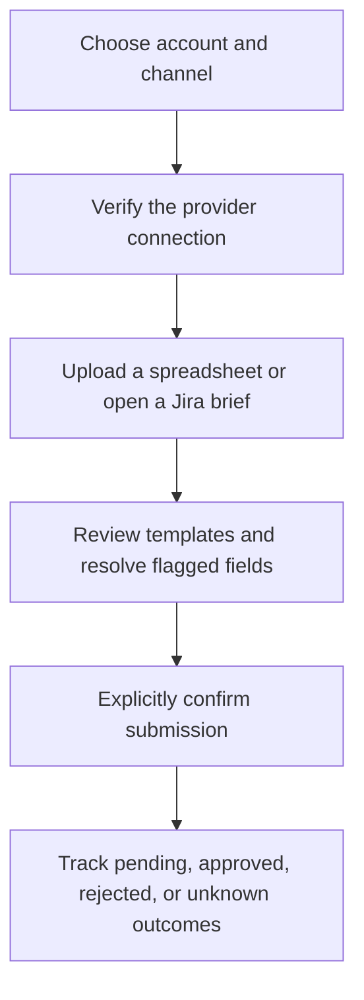

# Attributics Campaign Operations

A web application for reviewing business-message templates, requesting provider
approval, and tracking the work around a campaign.

Built for authorized operations teams working with **Bajaj**, **Tata Capital**,
and **Apparel**. The tools available to each team depend on its organization,
account, channel, and permissions. This repository contains the application,
provider integrations, browser extension, and automated checks.

[Open the application](https://whitelisting-agent.onrender.com) ·
[Setup and technical reference](README-REFERENCE.md)

## What does “whitelisting” mean?

A template is a reusable message format—for example, a payment reminder with
placeholders for a customer's name, amount, and due date. Whitelisting means
submitting that format for approval by the relevant messaging provider or registry.

Without this application, operators move between client spreadsheets, Jira tickets,
provider portals, and tracking sheets. The application brings template review,
registration, and status tracking into one workspace.

**Submitting a template is not the same as receiving approval, and approving a
template does not send a message to a customer.**

## What you can do

- **Read campaign briefs.** Import Excel/CSV files or open Jira briefs and their
  attachments. Review detected messages across worksheets, variants, and languages,
  with their original source references.
- **Find templates that need work.** Compare a master catalog with the provider's
  inventory to identify approved, missing, changed, pending, or rejected templates.
- **Request template approval.** Review message text, languages, variables, media,
  and buttons before submitting WhatsApp/RCS templates through Karix or Tata SMS
  content templates through VILPOWER's DLT portal.
- **Track outcomes and handoffs.** Follow submission and approval status, inspect
  activity, manage Jira work, and use configured deadline/SLA notifications.
- **Work with MoEngage.** Use account-specific tools for RCS template sync,
  campaign reporting, and click counts. Apparel also has attribution reporting
  and WhatsApp campaign-draft creation; those drafts are not launched by this flow.

## How the template workflow fits together

## The systems involved

| System | Its role |
| --- | --- |
| **Karix** | The messaging provider used for WhatsApp and RCS template operations. WhatsApp approval involves Meta. |
| **VILPOWER / DLT** | Tata Capital's SMS content-template registration and approval workflow. DLT is the registry used for Indian business SMS. |
| **Jira** | Campaign requests, source briefs, attachments, and operational handoffs. |
| **MoEngage** | Connected campaign, template-sync, and reporting workflows, depending on the account. |
| **Auth Sync extension** | Connects supported, signed-in provider sessions to the correct application account and integration. |

Not every integration is available to every organization. Bajaj, Tata Capital,
and Apparel credentials, workspaces, and data remain separate.

## Important boundaries

- **An upload is a preview, not permission to submit.** Operators review the
  destination and content before confirming a registration.
- **Uncertainty stays visible.** Ambiguous languages require a choice; unavailable
  inventory is not treated as an empty catalog. Unknown submission outcomes must
  be reconciled rather than blindly retried.
- **Provider sessions can expire.** A human may need to sign in again and refresh
  the supported connection. The application does not bypass login, OTP, or CAPTCHA.
- **Providers decide approval.** The application automates the workflow, not the
  provider's decision. Customer-message delivery is separate from template approval.

## Getting started

**Using an existing deployment:** sign in with an authorized account, choose the
correct organization/account and channel, and connect the relevant provider in
Settings. Then start with **Jira Briefs** or **Upload templates**. An administrator
must grant access; choosing an organization does not grant permissions.

**Running or extending the application:** start with the
[full technical reference](README-REFERENCE.md). It contains the existing setup,
environment variables, account-specific procedures, deployment instructions,
provider quirks, troubleshooting, and verification notes.

The application uses a **Next.js/TypeScript frontend**, a **Python/FastAPI backend**,
and **SQLite or PostgreSQL** for persistence. Docker packages the production services.

- [backend/](backend/) — APIs, template parsing, provider clients, queues, and tracking.
- [frontend/](frontend/) — the operator workspace.
- [browser-extension/](browser-extension/) — provider-session connection support.
- [tests/](tests/) — automated workflow and integration safeguards.
- [samples/](samples/) — example input files.
- [docs/](docs/) — focused integration and operational documentation.

The previous README is preserved in full as
[README-REFERENCE.md](README-REFERENCE.md); this page is the newcomer-facing overview.
